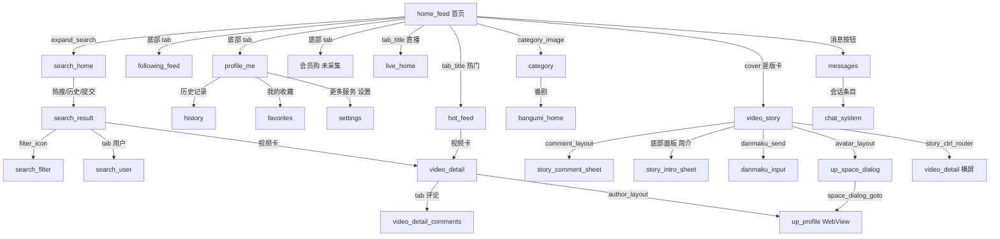

# B站自动化逻辑手册（手机4 实测）

> 配合 `pages/*.json` 使用。页面文件回答「有什么控件」，这份文件回答「怎么判断、怎么走、怎么读、哪里会翻车」。
> 采集时间：2026-10-31 20:11–20:14　｜　设备：手机4 `192.168.31.248:5555`　｜　版本：v9.16.1

---

## 一、页面识别表（先认页，再动手）

**不要用 Activity 名判断页面**——同一个 `MainActivityV2` 装了 6 个页面，同一个 `StoryVideoActivity` 装了 4 层浮层。

按下面的锚点判断，**从上到下匹配，命中即停**：

| 顺序 | 页面 key | 判定锚点（必要条件） |
|---|---|---|
| 1 | `story_comment_sheet` | 存在 `design_bottom_sheet` 且含 `cmt3_recycler` |
| 2 | `story_intro_sheet` | 存在 `design_bottom_sheet` 且含 `story_bottom_pager` + 文本「相关视频」 |
| 3 | `up_space_dialog` | 存在 `design_bottom_sheet` 且含 `space_list` |
| 4 | `danmaku_input` | 存在 `player_input_edit` 且含 `danmaku_input_options` |
| 5 | `video_story` | 存在 `story_view_pager` 且 `story_ctrl_layer_action` |
| 6 | `video_detail_comments` | 存在 `comment_container` 且 `tab_title`=「评论」selected |
| 7 | `video_detail_portrait` | 存在 `round_container` 且 `tab_title` 含「简介」 |
| 7.5 | `bangumi_detail` | 存在 `episode_selector_episode_switch`（选集区，普通视频没有） |
| 8 | `video_detail`（横屏） | 根节点宽 1920 且 `video_area` 全屏 |
| 9 | `search_filter` | 存在 `filter_flow_layout` 或 `pub_time_start` |
| 10 | `search_user` | 存在 `user_nested_container` |
| 10.5 | `search_live` | 存在 `info_online` + 文本「全部直播间」 |
| 10.6 | `search_bangumi` | 存在 `ogv_container` 且 `tab_title`=「番剧」selected |
| 10.7 | `search_movie` | 存在 `styles_container` 或 `follow_button_layout` |
| 10.8 | `search_column` | 存在 `column_nested_container` 或 `parent_layout` |
| 10.9 | `column_detail` / `dynamic_detail` | 文本含「点我发评论」（两者共用）；前者另有「篇」文集、后者有九宫格 |
| 11 | `search_result` | 存在 `search_result_layout` + `tabs_container` |
| 12 | `search_home` | 存在 `search_src_text` 或 `search_discover_list` |
| 13 | `settings_autoplay` | 文本含「视频详情页直接全屏」 |
| 13.5 | `settings_playback` | 文本含「竖屏模式设置」或「小窗播放/后台听视频设置」 |
| 13.55 | `settings_danmaku` | 文本含「记忆弹幕开关状态」或「字幕拖拽」 |
| 13.56 | `settings_float` | 文本含「应用外自动小窗播放」或「后台听视频」 |
| 13.6 | `ranking` | 文本含「全区排行榜」或 `tv_rank_num` |
| 13.65 | `playlist_square` | 文本含「片单广场」 |
| 14 | `settings` | 存在 `BiliPreferencesActivity` + `recycler_view` + 文本「账号资料」 |
| 14 | `history` | 文本「历史记录」+「批量管理」 |
| 15 | `messages` | 文本「消息」+ label「一键已读」 |
| 16 | `chat_system` | 有会话名标题 + 卡片式通知（无输入框） |
| 17 | `favorites` | 存在 `tab_title`=「收藏」/「追更」 |
| 18 | `bangumi_home` | 文本含「正在热播」+「追番」 |
| 18.5 | `movie_home` | 存在 `cvContainer` 且文本含「猜你想追」 |
| 18.55 | `ogv_filter` | 存在 `layout_filter` 或 `rv_filter` |
| 18.6 | `movie_channel` / `movie_channel_tv` | 文本含「找电影」/「找电视剧」/「找纪录片」+ `ogvImage` |
| 19 | `up_profile` | 存在 `web_view`（且 Activity=LocalAuthorSpaceActivity） |
| 20 | `category` | 文本「全部分区」+「快捷访问」 |
| 21 | `live_room` | 存在 `bottom_controllers_group` 或 `roomContainerView` |
| 21.5 | `live_home` | 存在 `liveTabContainer` |
| 22 | `hot_feed` | 存在 `hot_entrance_compose` |
| 23 | `following_feed` | 存在 `dy_list` 或 `following_home_container` |
| 24 | `home_feed` | 存在 `primary_multi_page_layout` + `bottom_navigation` |
| 25 | 兜底 | 以上都不中 → 视为未知页，**回首页重来**，不要盲点 |

---

## 二、导航图



### 关键转场（实测已验证的）

| 起点 | 动作 | 终点 | 备注 |
|---|---|---|---|
| home_feed | 点 `expand_search` | search_home | 稳定 |
| search_home | 点热搜 `rank_title` | search_result | 稳定 |
| search_result | 点 `filter_icon` | search_filter | 稳定 |
| search_result | 点 `tab_title`=用户 | search_user | 稳定 |
| hot_feed | 点卡片 `cover` | **video_detail（横屏）** | ⚠️ 会横屏+浮层 |
| home_feed | 点竖版卡 `cover` | video_story | 稳定 |
| video_story | 点 `comment_layout` | story_comment_sheet | ⚠️ 第一次点常被当成「唤出控制栏」，要点第二次 |
| video_story | 点 `avatar_layout` | up_space_dialog | 稳定 |
| up_space_dialog | 点「进入空间」 | up_profile（WebView） | 控件不可读 |
| video_story | 点 `story_ctrl_router` | 横屏全屏 | ⚠️ 不是新页面，是转屏 |
| profile_me | 下滑到底 → 点「设置」 | settings | 「设置」在很下面，要滑两次 |

### 怎么进竖屏详情页（重要）

**不要从热门页点卡片**（必进横屏）。用 DeepLink：

```bash
adb -s 192.168.31.248:5555 shell am start -a android.intent.action.VIEW \
  -d 'bilibili://video/<BV号>'
```

实测能稳定进 `UnitedBizDetailsActivity` 的竖屏态（`round_container` + 简介/评论 tab）。

---

## 三、字段解析规则

B站大量把多字段塞进一个 `TextView` / `label`，必须用正则拆。

### 3.1 数量（播放/点赞/弹幕/收藏）

```
^\s*([\d.]+)\s*(万|亿)?\s*$
```
- `11.4万` → 114000
- `9593.5万` → 95935000
- `1.5万` → 15000
- 纯数字 → 原值

### 3.2 视频卡片大 label（首页/搜寻结果）

形如：
```
竖版视频,梁文锋变成了光？！！！,11.4万观看,153弹幕,时长1分钟53秒,UP主凉风Zephyr,1万点赞,
```
拆分顺序：`类型, 标题, 播放, 弹幕, 时长, UP主, 点赞`
- 类型：`竖版视频` / `创作推广`（广告）
- 「创作推广」= 广告，直接跳过
- 但没有点赞的卡片会少一个字段 → **按 key 前缀匹配，不要按固定下标**

### 3.3 详情页元信息行

```
playCount11.6万   danmaku154   2026年10月30日 11:11   BV14gxc61Eux   copyright未经作者授权禁止转载
```
- `playCount(?P<play>[\d.万亿]+)`
- `danmaku(?P<danmaku>\d+)`
- `(?P<date>\d{4}年\d{1,2}月\d{1,2}日\s*\d{1,2}:\d{2})`
- `(?P<bvid>BV[0-9A-Za-z]{10})`
- 版权：`未经作者授权禁止转载` / `自制` 等

### 3.4 互动按钮 label（详情页最重要）

详情页五个按钮的 label 自带**当前总数**：

| 控件 | label 样例 | 作用 |
|---|---|---|
| `frame_like` | `点赞，15092个点赞` | 读总数 + 判断是否已赞 |
| `frame_coin` | `投币，983个投币` | 读总数 |
| `frame_fav` | `收藏，2535个收藏` | 读总数 |
| `frame_share` | `分享，1676个分享` | 读总数 |
| `frame_dislike` | `不喜欢` | 无数值 |

**「是否已操作」的判定**：除了 label，还要看进度节点是否出现——
- 已投币 → 存在 `coin_progress`
- 已收藏 → 存在 `favorite_progress`
- 已点赞 → `like_num` 的数字变化（这个不可靠，label 最可靠）

### 3.5 评论时间 + IP

```
(?P<rel>昨天|今天|前天|\d+天前|\d+小时前|\d+分钟前|\d{4}年\d{1,2}月\d{1,2}日)\s+(?P<time>\d{1,2}:\d{2})\s+(?P<ip>\S+)
```
例：`昨天 11:41 广东`

### 3.6 粉丝数与投稿数

```
(?P<fans>[\d.万亿]+)粉丝(\s*·\s*(?P<videos>\d+)个视频)?
```
例：`9.9万粉丝` / `45.5万粉丝 · 11个视频`

---

## 四、状态语义（怎么知道"已经做过了"）
| 动作 | 状态信号 | 位置 |
|---|---|---|
| 弹幕开关 | `label` 在「关闭弹幕 / 开启弹幕」切换；`checked` 属性 | video_detail / story |
| 收藏 | `favorite_progress` 节点存在 | video_detail |
| 投币 | `coin_progress` 节点存在 | video_detail |
| 关注 | 按钮文案「关注」→「已关注」（实测未做，按常规推断） | follow |
| 底部 tab 选中 | `selected` 属性在 tab 容器上 | bottom_navigation |
| 顶部分区选中 | `selected` 在 tab_title 上 | tabs |
| 搜索 tab 选中 | `selected` 在 tab_title 上 | search_result |
| 弹幕颜选中 | `item_root` 的子节点差异（未细采） | danmaku_input |

---

## 五、WebView 的三态（别一概而论）

B站 的「WebView 页面」并不是同一种东西，实测有三种：

| 容器 Activity | 例子 | uiautomator 能读到什么 |
|---|---|---|
| `WebGeneralComposeActivity` | 每周必看、入站必刷 | **文本节点可读**（TextView/Image 都在），但内部 id 是随机哈希，只能靠文本 |
| `MWebActivity` | 预测广场 | 只有 `webview` 容器，**内部完全不可读** |
| `LocalAuthorSpaceActivity` | UP 主主页 | 只有 `web_view` 容器，**内部完全不可读** |

**结论**：判断「这页能不能自动化」不要看它是不是 WebView，要看它跑在哪个 Activity 里。同一入口条上（热门 → 每周必看 / 入站必刷 / 预测广场）就并存了可读和不可读两种。

---

## 六、风险矩阵

| 风险 | 控件 | 处理 |
|---|---|---|
| `none` | 所有导航、tab、返回、标题、进度、搜索、筛选展开 | 可直接点 |
| `send` | 点赞、点踩、投币、收藏、分享、关注、评论、回复、发弹幕、发布、账号切换 | **必须主人确认**；自动化里应默认 dry-run |
| `forbidden` | 我的钱包、会员购订单、必火推广、退出登录、清空搜索历史（本地）、清理存储空间 | 代码层面直接拒绝 |

**特别注意**：`frame_like` / `frame_coin` / `frame_fav` / `frame_share` 这几个是 `Button` 类型，`label` 里带动作名，**只要点下去就生效**，没有二次确认弹窗（投币有面板，点赞/收藏/分享直接生效或弹面板）。所以宁可先读 label 再决定。

---

## 七、已知坑与对策

| # | 坑 | 现象 | 对策 |
|---|---|---|---|
| 1 | 点击视频卡进横屏 | 手动点热门卡片 → 横屏全屏 + 大会员浮层，BACK 被吃 | 用 DeepLink `bilibili://video/BVxxx` |
| 2 | 评论区要点两次 | Story 页第一次点「评论」只唤出控制栏 | 点两次，或用 `comment_text` 判断 |
| 3 | 设置藏在最底 | 「我的」页要下滑两次才见「设置」 | 先 `swipe up` 到底再找 |
| 4 | 分区按钮难点 | 直接点 `category_click_area` 坐标无反应 | 点 `category_image` 节点（ref） |
| 5 | Compose 页面无 id | 历史/消息/番剧/UP弹层 只有 View+TextView | 用 label/text 匹配；接受不稳定性 |
| 6 | UP 主页是 WebView | 只能拿到 `web_view` 容器 | 走 `up_space_dialog` 替代；要完整主页需 CDP |
| 7 | 广告混在列表里 | 首页 `ad_tint_frame`、热门 `ad_tag_v2` | 按 label 含「创作推广」/节点含 `ad_` 前缀跳过 |
| 8 | 内容不可作锚点 | 搜索词、热搜、横幅文案每次都变 | 锚点只用结构性控件 id |
| 9 | 大会员横幅文案会变 | 同一次会话内从「大会员体验邀请」变成「您的特惠福利已到账」 | 别用文案判断页面 |
| 10 | 视频自动播放 | Story 页视频自动播，操作慢就被切走 | 先点暂停（`story_ctrl_play`），再操作 |
| 11 | 弹幕/评论输入框占位文案动态 | 「你渴望拥有力量吗？评论让力量更强大」 | 用 `input` 的 id，不用占位文案 |
| 12 | 搜索结果页不是新 Activity | 切 tab 后 Activity 仍是 BiliMainSearchActivity | 用 tab 的 selected + 容器 id 判断 |
| 13 | 横屏/竖屏切换 | `story_ctrl_router` 会让整个 Activity 转屏 | 操作前记 `get_orientation`，转屏后重新 dump |
| 14 | 列表 id 复用 | `item_recycle`、`title`、`more`、`cover` 到处都是 | 必须加上下文（父容器 id 或文本）再定位 |
| 15 | 直播间运营层遮挡 | `live_operation_banner_container` 1080x1536 几乎盖满，点击被吃 | 优先点具体 id（follow_plus / live_send_danmaku），别点坐标 |
| 16 | 直播间送礼误触 | `fr_speedy_send_gift` 一键送礼**直接扣费** | 列为 forbidden，自动化前先排除该区域坐标 |
| 17 | 详情页横屏非必然 | 同一路径（热门→点卡片）有时横屏、有时竖屏（已实测两次） | 动作前先 `get_orientation`；横了就 `set_orientation portrait` 再操作 |
| 17.5 | 横屏有两个诱因 | ①「视频详情页直接全屏」开关（实测为关）②「启用重力感应旋屏」开关（实测为开，设备一倾斜就转全屏） | 排查横屏先看这两个设置；自动化时考虑禁用或固定方向 |
| 18 | 多个 Activity 叠加 | 返回一次不一定回首页，可能退到上一个详情 | 循环 BACK + 每次校验 `identify()`，别用固定次数 |
| 19 | 播放中 ref/坐标会失效 | 视频播完会**自动连播**到下一个、甚至跳进直播间，旧 ref 全废 | 每次动作前重新 dump；播完前操作，或先暂停 |
| 20 | 投币面板默认连带点赞 | 「同时点赞内容」CheckBox 默认勾选 | 要做投币必须先显式取消，否则一次点击产生两个对外动作 |
| 21 | 「更多操作」只在横屏 | 竖屏详情页点视频区唤不出 `toolbar_action_overflow`（3 次尝试均失败） | 要采这个菜单必须先转横屏（`set_orientation landscape`），竖屏无解 |
| 22 | 发评论的键叫「发布」 | 不叫「发送」，且**没有 id**，只能按 text 定位；`disabled` 属性不体现，空内容也能匹配到 | 自动化要自己判断输入框有无内容，别信 disabled |
| 23 | 回复输入框自带 @ | 占位提示「回复 {用户名}：」，输入后消失，发送时自动 @ | 模板里**不要**再手动加「回复 @xxx」，会重复 |
| 24 | 「转到动态」是隐藏副作用 | 左下角圆形勾选，勾上后发评论会**同时发一条动态** | 发评论前必须确认它未勾选 |
| 25 | 消息中心垃圾桶=一键已读 | 点了弹「是否清除全部新消息提醒？」 | 别误点；这是清未读，不是私信入口 |
| 26 | 陌生人主页没有私信入口 | 未关注时主页只有「+ 关注」，更多菜单也无私信 | 私信入口见 `dm_entry_investigation.md`，当前未打通 |

---

## 八、给自动化代码的最小骨架建议

```
1. dump 一次
2. 按「页面识别表」判断当前页 → 未知就回首页
3. 取目标控件：优先 id，其次 label 正则，最后 text 正则
4. 读状态（是否已赞/已藏）→ 决定是否要动作
5. 风险闸门：risk=send 需外部授权；risk=forbidden 直接抛错
6. 动作后重新 dump，用「新页面的锚点」确认成功，而不是等固定时间
7. 失败重试上限 2 次，之后回首页重置
```

---

*本手册基于 v9.16.1 实测。B站前端迭代很快，控件 id 可能在小版本间变化，建议每次任务前先跑一遍「页面识别表」自检。*
